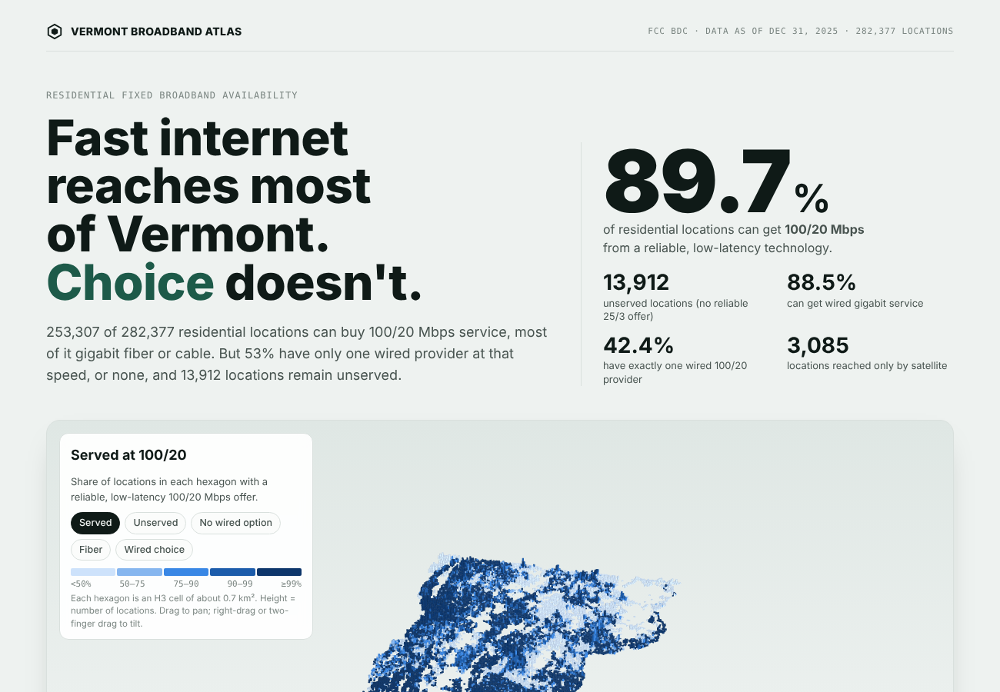

# Vermont Broadband Access & Digital Divide Analysis

Where can Vermont households get fast, reliable home internet, how much choice do they
have, and how does that line up with income and rurality?

This project combines the **FCC Broadband Data Collection** (all eight fixed technologies,
data as of December 31, 2025) with **U.S. Census ACS** estimates, and publishes the results
as an interactive dashboard with a 3D hexagon map.



Open `dashboard/web/index.html` in a browser for the interactive version.

## Key findings

Residential locations, reliable technologies (fiber, cable, copper, licensed fixed wireless):

| Metric | Value |
|---|---:|
| Residential locations analyzed | 282,377 |
| Served (≥ 100/20 Mbps, low latency) | **89.7%** (253,307) |
| Underserved (25/3 to 100/20) | 5.4% (15,158) |
| Unserved (< 25/3) | 4.9% (13,912) |
| Wired gigabit available | 88.5% |
| Exactly one wired 100/20 provider | 42.4% |
| No wired 100/20 provider | 10.9% |
| Satellite only | 1.1% (3,085) |

- **Coverage is high; choice is thin.** 53% of locations have one wired 100/20 provider or none.
- **The gap is regional.** Essex (55% served), Grand Isle (61%), Orleans (68%) and Caledonia (74%)
  trail the state. The Northeast Kingdom (Essex, Orleans, Caledonia) holds 12% of locations but
  37% of unserved ones. Rutland, Chittenden, Windsor and Bennington are above 96%.
- **Rurality limits access; income limits adoption.** Across census tracts, the served share
  tracks population density (Spearman ρ = 0.73) but not income (ρ = −0.06). Household
  broadband subscriptions (ACS) do rise with income (ρ = 0.35): wired subscription is 74%
  in the lowest-income quartile of tracts versus 82% in the highest.
- **Fiber-only figures are not market figures.** 91.6% of fiber-served homes have a single fiber
  provider, yet 69% of those homes have a second wired 100/20 provider, usually cable.

Full write-up: [`docs/findings.md`](docs/findings.md).

## Repository layout

```
data/
  raw/fcc/2025-12-31/   FCC CSV/ZIP files (git-ignored)
  raw/census/           Vermont ACS + Gazetteer extracts (versioned, ~20 KB)
  reference/            Census download manifest
  processed/            parquet outputs (git-ignored) and analysis/ tables (versioned)
src/vermont_broadband_analysis/
  config.py             paths, FCC codes, thresholds
  fcc.py                profile, validate, combine FCC files
  metrics.py            location table and aggregates
  census.py             ACS + boundary download
  socioeconomic.py      FCC x ACS join and associations
  places.py             towns, county outlines, county need index
  dashboard_data.py     dashboard data bundle and page
  cli.py                `vermont-broadband-analysis <step>`
notebooks/
  01_data_discovery     fiber file discovery (first exploration)
  02_data_quality       all-file validation and anomalies
  02b_fcc_schema_anomalies  B/R duplicate investigation
  03_exploratory_analysis   statewide, technology, competition, counties, providers
  04_socioeconomic      ACS join, density and income comparisons
sql/                    optional PostgreSQL schema and queries
dashboard/web/          app.html (source), index.html (built), data.json
docs/                   methodology, data dictionary, questions, findings
```

## Reproduce

Requires Python 3.13 and [uv](https://docs.astral.sh/uv/).

```bash
uv sync
# 1. Download the eight Vermont fixed-availability files (Dec 2025) from
#    https://broadbandmap.fcc.gov/data-download/nationwide-data?version=dec2025
#    into data/raw/fcc/2025-12-31/ and unzip them.
# 2. Run the pipeline
uv run vermont-broadband-analysis all
# open dashboard/web/index.html in a browser
```

Census inputs are read from `data/raw/census/` (see `data/reference/census_download_manifest.json`
for sources); `census.extract_summary_file()` rebuilds them from the ACS Summary File.

Steps can run one at a time: `profile`, `build`, `metrics`, `census`, `socioeconomic`,
`dashboard`. Use `all --skip-census` to run without network access to census.gov.

Optional SQL layer: create the table with `sql/schema/001_create_fcc_fixed_broadband.sql`,
then `DATABASE_URL="dbname=vermont_broadband" uv run python src/load_fcc_to_postgres.py`.

## Privacy and licensing

Only public U.S. government data is used (FCC BDC and U.S. Census Bureau; not subject
to copyright, 17 U.S.C. §105). No addresses, coordinates or FCC Location IDs (FCC Fabric,
owned by CostQuest) are published; location-level files stay local and are git-ignored.
Hexagons with fewer than 5 locations show no counts. Details in
[`docs/methodology.md` §8](docs/methodology.md#8-privacy-licensing-and-attribution).

## Method in brief

Tiers follow FCC/NTIA BEAD definitions: *served* = a reliable, low-latency offer of at least
100/20 Mbps; *unserved* = nothing reliable at 25/3. Availability is what providers report.
It does not measure price, adoption or real-world speed. Details and limitations:
[`docs/methodology.md`](docs/methodology.md).

## Sources

- Source data: FCC Broadband Data Collection, fixed availability, Vermont, Dec 31 2025 data.
- U.S. Census Bureau, American Community Survey 2020–2024 5-year estimates (table-based Summary File); 2024 Gazetteer; TIGERweb county outlines.
